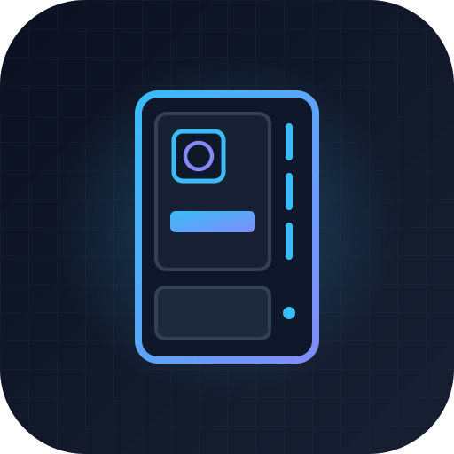
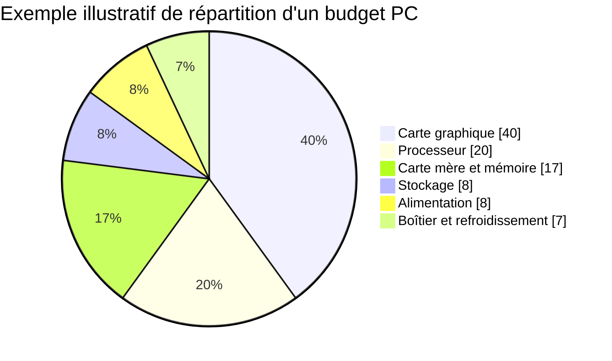
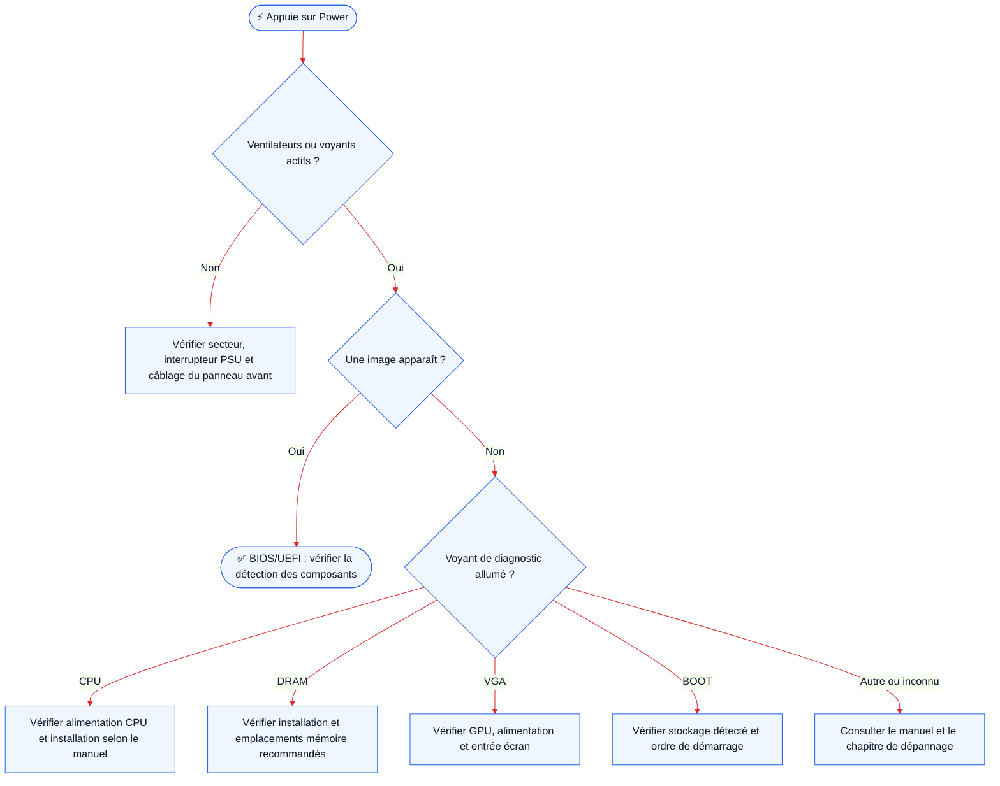

# ⚡ PCperso — v2.1 Candidate

### Le guide francophone pour choisir, monter et configurer son PC Gamer

**De l’idée au premier démarrage :** composants, compatibilité, montage, BIOS/UEFI, système, diagnostic et entretien — expliqués avec méthode, sans jargon inutile.

[**✨ Nouveautés**](#nouveautes) · [**🧭 Parcours**](#parcours) · [**📚 Sommaire**](#sommaire) · [**🧰 Outils**](#outils) · [**🛡️ Sécurité**](#securite) · [**🩺 Diagnostic**](#diagnostic) · [**🤝 Contribution**](#entraide)

 

---

## 🎯 À propos

**PCperso** est une documentation communautaire pour aider à concevoir, assembler, configurer et dépanner un PC. Elle s’adresse autant aux personnes qui montent leur première machine qu’aux passionnés qui souhaitent vérifier une configuration ou faire évoluer un ordinateur existant.

> [!TIP]
> **Le parcours conseillé :** définis ton usage et ton budget, vérifie les composants et les dimensions, assemble méthodiquement, puis contrôle la machine avant de l’utiliser au quotidien.

| Ton besoin | Commence ici |
|:--|:--|
| **Choisir une configuration** | [Chapitre 01](./guide/01-composants-compatibilite.md) et [outils de configuration](./outils/README.md) |
| **Préparer le montage** | [Chapitre 02](./guide/02-preparation-et-connecteurs.md) et [checklist](./CHECKLIST.md) |
| **Assembler et démarrer** | [Chapitres 03 à 05](#sommaire) |
| **Résoudre un problème** | [Chapitre 06](./guide/06-diagnostic-et-pannes.md) et [fiche mémo](./outils/fiche-memo-cablage-et-debug.md) |
| **Faire évoluer son PC** | [Guide d’upgrade](./outils/guide-upgrade-pc.md) |

---

## ✨ Édition v2.1 Candidate

La v2.1 Candidate met en avant les ressources déjà présentes dans le dépôt et clarifie la navigation du guide. **Candidate ne signifie pas validation finale** : le contenu, les liens, les consignes matérielles et les ressources doivent être relus avant toute annonce de version stable.

- **Navigation plus cohérente :** accès aux guides, outils, scripts et documents de suivi réellement présents dans le dépôt.
- **Aide au choix :** configurations types, vérificateur de compatibilité et guide d’upgrade disponibles dans `outils/`.
- **Montage plus sûr :** rappels sur les câbles, les dégagements matériels et l’examen des scripts avant exécution.
- **Documentation mieux orientée :** parcours de montage, raccourcis et diagrammes Mermaid intégrés au rendu GitHub.

> [!IMPORTANT]
> Les recommandations de compatibilité, de puissance et de composants dépendent des références exactes et des informations fabricants. Les outils de ce dépôt sont des aides documentaires : vérifie les fiches techniques avant tout achat ou branchement.

---

## 🧭 Parcours de montage

```mermaid
%%{init: {"theme":"base","themeVariables":{"primaryColor":"#DBEAFE","primaryTextColor":"#0F172A","primaryBorderColor":"#2563EB","lineColor":"#64748B","secondaryColor":"#FEE2E2","tertiaryColor":"#EFF6FF","fontFamily":"Arial"}}}%%
flowchart LR
    A["🎯 Usage et budget"] --> B["🧩 Choix et compatibilité"]
    B --> C["🔌 Préparation des pièces"]
    C --> D["🛠️ Montage et câblage"]
    D --> E["⚙️ BIOS, système et pilotes"]
    E --> F["🧪 Tests, entretien et évolutions"]
    classDef blue fill:#DBEAFE,stroke:#2563EB,color:#0F172A,stroke-width:2px
    classDef red fill:#FEE2E2,stroke:#DC2626,color:#0F172A,stroke-width:2px
    class A,B,C,D,E blue
    class F red
```

### Exemple de répartition budgétaire — purement indicatif

Cette répartition illustrative n’est pas une recommandation universelle. Les tarifs et priorités changent selon le pays, la période, l’usage et les composants déjà possédés. Compare les prix actuels et garde une marge pour les périphériques et imprévus.

---

## 📚 Sommaire opérationnel

Suis les chapitres dans l’ordre pour un premier montage. Si tu as déjà un PC, passe directement au diagnostic ou au guide d’upgrade.

| Étape | Chapitre | Objectif | Accès |
|:--:|:--|:--|:--|
| **01** | 🧩 **Composants et compatibilité** | Vérifier plateforme, mémoire, dimensions et alimentation. | [Ouvrir](./guide/01-composants-compatibilite.md) |
| **02** | 🔌 **Préparation et connecteurs** | Identifier les câbles, prises et éléments à préparer. | [Ouvrir](./guide/02-preparation-et-connecteurs.md) |
| **03** | 🛠️ **Assemblage et câblage** | Installer les composants et réaliser les branchements. | [Ouvrir](./guide/03-assemblage-et-cablage.md) |
| **04** | ⚙️ **BIOS / UEFI et profils mémoire** | Découvrir les réglages de démarrage et profils mémoire. | [Ouvrir](./guide/04-bios-uefi-et-xmp-expo.md) |
| **05** | 🪟 **Système, pilotes et tests** | Installer le système et vérifier les pilotes et l’affichage. | [Ouvrir](./guide/05-windows-pilotes-et-tests.md) |
| **06** | 🩺 **Diagnostic et pannes** | Suivre une démarche de dépannage adaptée aux symptômes. | [Ouvrir](./guide/06-diagnostic-et-pannes.md) |
| **07** | 📖 **Glossaire matériel** | Comprendre les acronymes et termes du matériel PC. | [Ouvrir](./guide/07-glossaire-hardware.md) |
| **08** | 🌬️ **Refroidissement et entretien** | Comprendre le flux d’air et les gestes d’entretien. | [Ouvrir](./guide/08-refroidissement-et-entretien.md) |

**Raccourcis :** [Checklist](./CHECKLIST.md) · [Index des guides](./guide/README.md) · [Index des outils](./outils/README.md) · [Index des scripts](./scripts/README.md)

---

## 🧰 Outils, fiches et scripts

| Ressource | Utilité | Accès |
|:--|:--|:--|
| 🎯 **Configurations types** | Exemples à adapter à l’usage, au budget et aux prix locaux. | [Configs types](./outils/configs-types.md) |
| 🔍 **Vérificateur de compatibilité** | Aide au repérage des points à vérifier ; confirme les spécifications auprès des fabricants. | [Vérificateur](./outils/verificateur-compatibilite-2026.md) |
| 🧮 **Budget et puissance** | Méthode de suivi des achats et d’estimation à valider selon les composants. | [Guide](./outils/calculateur-budget-puissance.md) · [Modèle CSV](./outils/modele-config-budget.csv) |
| 🔖 **Fiche mémo câblage et diagnostic** | Repères rapides pendant le montage et au premier démarrage. | [Ouvrir](./outils/fiche-memo-cablage-et-debug.md) |
| ✅ **Checklist de montage** | Suivre les contrôles et les étapes du projet. | [Checklist](./CHECKLIST.md) |
| 🔄 **Guide d’upgrade** | Préparer l’évolution d’un PC existant. | [Guide](./outils/guide-upgrade-pc.md) |
| ⚙️ **Scripts** | Index, modes d’emploi et scripts présents dans le dépôt. Lis et vérifie leur contenu avant exécution. | [Index des scripts](./scripts/README.md) · [Script PowerShell](./scripts/pack_logiciels_pc_neuf.ps1) |

---

## 🧩 Contrôles de compatibilité avant achat

Confirme ces points dans les manuels et fiches techniques officiels des références exactes :

- **CPU ↔ carte mère :** socket, chipset, génération supportée et version BIOS nécessaire.
- **Mémoire :** type DDR, capacité, nombre de barrettes et compatibilité annoncée par la carte mère.
- **GPU ↔ boîtier :** longueur, épaisseur, dégagement des câbles et espace réservé aux ventilateurs/radiateurs.
- **Refroidissement :** hauteur du ventirad, dimensions d’AIO et compatibilité socket.
- **Stockage :** format M.2, interface, lignes disponibles et éventuel partage des connecteurs.
- **Alimentation :** puissance et connecteurs requis par les composants, selon les recommandations de leurs fabricants.
- **Usage :** résolution, fréquence d’écran, logiciels et budget total, périphériques compris.

> [!NOTE]
> Les outils du dépôt sont des aides à la vérification, pas une certification automatique de compatibilité. Les révisions de matériel et BIOS peuvent changer les résultats.

---

## 🛡️ Sécurité matérielle et logicielle

> [!WARNING]
> Avant d’intervenir dans le boîtier, éteins l’ordinateur, coupe l’alimentation et débranche le câble secteur. Manipule les composants avec précaution et suis les consignes de leurs fabricants.

- **Câbles modulaires :** utilise uniquement les câbles fournis avec l’alimentation ou explicitement déclarés compatibles avec son modèle exact. Une même marque ne garantit pas un brochage identique.
- **Connecteurs GPU :** utilise le câblage prévu par le fabricant ; assure-toi que le connecteur est correctement inséré et respecte les dégagements et courbures indiqués dans la notice.
- **Refroidissement :** consulte les instructions d’installation et vérifie les films de protection avant de monter le refroidisseur.
- **BIOS/UEFI :** n’effectue une mise à jour qu’avec le fichier officiel correspondant exactement à la carte mère et dans des conditions d’alimentation stables.

> [!CAUTION]
> **Scripts :** lis et vérifie le code ainsi que les sources de téléchargement avant exécution. Comprends les paramètres et les privilèges requis. N’exécute pas de script avec des droits élevés si tu n’en comprends pas les actions.

---

## 🩺 Diagnostic express au premier démarrage

Ce diagramme propose des vérifications initiales. Les voyants et procédures varient selon les cartes mères : consulte leur manuel.

Voir le [chapitre 06 — Diagnostic et pannes](./guide/06-diagnostic-et-pannes.md) et la [fiche mémo](./outils/fiche-memo-cablage-et-debug.md).

---

## 🚀 Parcours express

<strong>Afficher le parcours recommandé pour le jour du montage</strong>

1. **Avant l’achat :** définis l’usage et le budget ; lis le [chapitre 01](./guide/01-composants-compatibilite.md).
2. **Avant l’assemblage :** consulte le [chapitre 02](./guide/02-preparation-et-connecteurs.md), la [checklist](./CHECKLIST.md) et les manuels des composants.
3. **Pendant le montage :** suis le [chapitre 03](./guide/03-assemblage-et-cablage.md) ; ne force pas les connecteurs.
4. **Au premier démarrage :** vérifie la détection du matériel dans le BIOS/UEFI avant l’installation du système.
5. **Après installation :** consulte les chapitres pilotes/tests et refroidissement selon les besoins de la machine.

---

## 🤝 Entraide, suivi et contribution

| Besoin | Ressource |
|:--|:--|
| 🆘 **Question ou signalement** | [Issues du dépôt](https://github.com/teremuhamblin/PCperso/issues) |
| 🗺️ **Feuille de route** | [`docs/ROADMAP.md`](./docs/ROADMAP.md) |
| 📋 **Historique des versions** | [`docs/CHANGELOG.md`](./docs/CHANGELOG.md) |
| 🛠️ **Contribuer** | [Guide de contribution](./.github/CONTRIBUTING.md) |
| 📚 **Explorer les guides** | [Index des chapitres](./guide/README.md) · [Index documentaire](./docs/README.md) |
| 🧰 **Explorer les ressources** | [Outils](./outils/README.md) · [Scripts](./scripts/README.md) |

---

## 📜 Licence

Consulte [`LICENSE`](./LICENSE) pour les conditions applicables à la réutilisation et au partage du contenu.

---

**PCperso v2.1 Candidate** · Un guide communautaire pour monter son PC avec méthode  
[⬆️ Retour en haut](#top)

