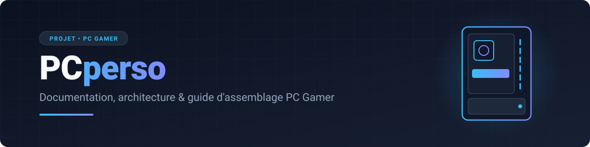
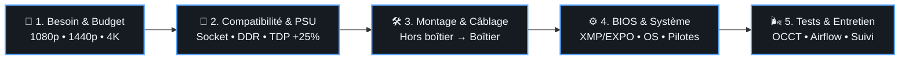
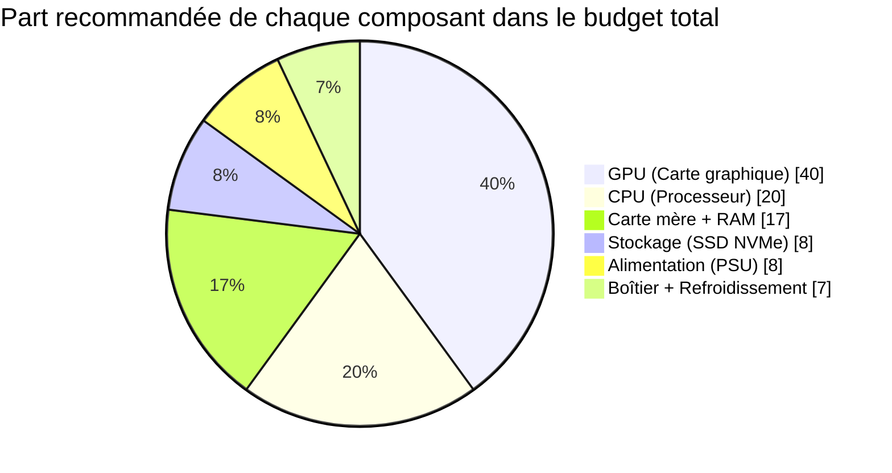
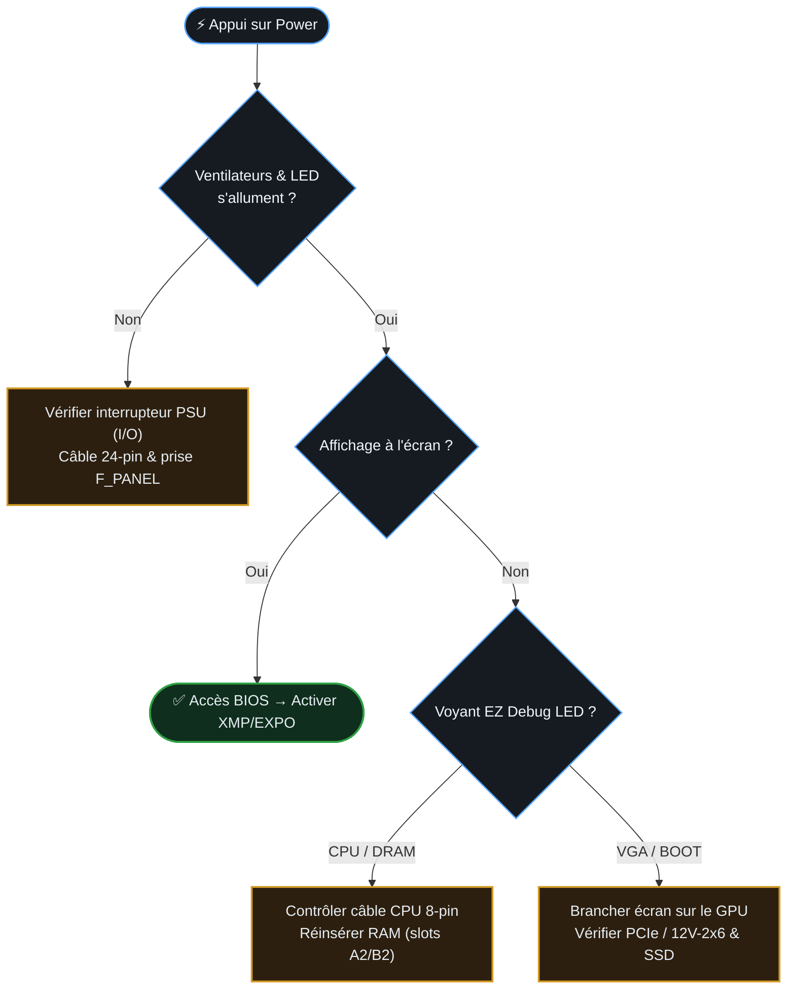

###### Voici le **`README.md` complet en version `v2.0 Stable`**, conçu pour être **100 % compatible avec GitHub** (rendu natif clair/sombre, zéro script externe fragile, ancres HTML sécurisées, alertes officielles GitHub et diagrammes Mermaid natifs), intégrant l'évolution **v1.3 → v1.9 → v2.0 Stable**.

---

###### 1. Le fichier `README.md >> markdown`
<a id="top"></a>

<p align="right">
  <a href="https://github.com/teremuhamblin/PCperso/stargazers">
    
  </a>
  <a href="./.github/FUNDING.yml">
    
  </a>
</p>

<div align="center">

<!--
  Astuce Thème Clair/Sombre (optionnel) :
  Si tu crées plus tard `assets/banner-dark.svg` et `assets/banner-light.svg`, remplace la ligne ci-dessous par :
  <picture>
    <source media="(prefers-color-scheme: dark)" srcset="assets/banner-dark.svg">
    <source media="(prefers-color-scheme: light)" srcset="assets/banner-light.svg">
    
  </picture>
-->


# ⚡ PCperso — Édition `v2.0 Stable`

### 🖥️ *Tout savoir sur le Montage d'un PC Gamer*
#### 🎮 *Le Guide complet de A à Z : choisir, assembler, configurer et sécuriser ton PC sans stress*

<br>

[](./CHANGELOG.md)
[](#sommaire)
[](#top)
[](#top)
[](#nouveautes)

<br>

*Apprends à concevoir une configuration équilibrée, vérifier chaque compatibilité physique et électrique, assembler ta machine pas à pas, régler ton BIOS/UEFI, installer Windows proprement et diagnostiquer la moindre panne.*

<br>

[✨ Nouveautés v2.0](#nouveautes) • [🗺️ Parcours & Graphiques](#parcours) • [📚 Sommaire](#sommaire) • [🧰 Outils & Scripts](#outils) • [🛡️ Sécurité](#securite) • [🩺 Diagnostic](#diagnostic) • [🤝 Entraide](#entraide) • [📜 Licence](#licence)

</div>

---

> [!TIP]
> **🎯 C'est fait pour toi si tu es :**
> * 🌱 **Débutant complet** souhaitant monter son premier PC Gamer sans risque d'erreur ni crainte de casser un composant.
> * 🔧 **Passionné ou futur builder** cherchant une référence claire, vérifiée, à jour des derniers standards matériels et sans jargon inutile.

<a id="nouveautes"></a>

> [!NOTE]
> ### ✨ Quoi de neuf dans la `v2.0 Stable` ? *(Consolidation v1.3 → v2.0)*
> * 🧭 **Expérience unifiée & lisible :** refonte complète de la navigation, ancres sécurisées, schémas visuels Mermaid et parcours guidé de bout en bout.
> * 📐 **Contraintes physiques & stockage :** vérification complète des dégagements boîtier (longueur GPU, hauteur ventirad, radiateurs AIO) et recommandations SSD NVMe / périphériques.
> * ⚖️ **Budget, TDP & Résolutions :** répartition optimale du budget, dimensionnement PSU (`TDP + marge 25–35 %`) et profils `1080p` / `1440p` / `4K`.
> * 🛡️ **Sécurité matérielle & logicielle :** garde-fous explicites sur le câblage `12V-2x6`, l'électricité statique (ESD), le flash BIOS et l'audit des scripts PowerShell (`Winget`).
> * 📋 *Historique détaillé version par version disponible ci-dessous et dans [`CHANGELOG.md`](./CHANGELOG.md).*

<details>
<summary>🕰️ <b>Historique complet des évolutions intégrées (v1.3 → v2.0 Stable)</b> <i>(Clique pour déplier)</i></summary>

<br>

| Version | Palier | Apports principaux consolidés dans la v2.0 Stable |
| :---: | :--- | :--- |
| **v1.3** | 📐 Dimensions, NVMe & Périphériques | Contraintes physiques (mm), guide SSD NVMe PCIe 4.0/5.0 et choix écran/clavier/souris. |
| **v1.4** | 🩺 Post-montage & Diagnostic | Arbre de diagnostic *No-POST* / EZ Debug LED, réglages BIOS avancés et mise à jour architecture. |
| **v1.5** | 📊 Comparateur & Exports | Comparaison côte à côte des configs par usage et standardisation des fiches de suivi. |
| **v1.6** | 🛡️ Sécurité & Accessibilité | Audit des liens, consignes ESD/PSU, lecture préalable des scripts et ergonomie clair/sombre. |
| **v1.7** | 🎯 Configs & Évolutivité | Profils ciblés par définition (`1080p` / `1440p` / `4K`) et conseils d'upgrade sur PC existant. |
| **v1.8** | ⚙️ Qualité & Automatisation | Normalisation Markdown, templates GitHub (`.github/ISSUE_TEMPLATE` & `PULL_REQUEST_TEMPLATE`) et contrôles qualité. |
| **v1.9** | 🧪 Release Candidate | Harmonisation complète des chapitres `01` à `08`, fiches mémos et checklists terrain. |
| **v2.0** | 🚀 **Version Stable** | Documentation consolidée, diagrammes visuels intégrés, sécurité renforcée et base prête pour les outils interactifs. |

</details>

---

<a id="parcours"></a>

## 🗺️ Parcours & Vue d'ensemble

### 1. Le cycle complet d'un montage réussi



### 2. Répartition indicative d'un budget PC Gamer équilibré



---

<a id="sommaire"></a>

## 📚 Sommaire du guide

| Étape | Chapitre | Ce que tu vas maîtriser | Mots-clés |
| :---: | :--- | :--- | :--- |
| **01** | 🧩 [**Composants & Compatibilité**](./guide/01-composants-compatibilite.md) | Choisir des pièces 100 % compatibles (socket, RAM, dimensions, PSU) et éviter les goulots d'étranglement. | <kbd>Socket</kbd> <kbd>Chipset</kbd> <kbd>Watts</kbd> |
| **02** | 🔌 [**Connecteurs & Préparation**](./guide/02-preparation-et-connecteurs.md) | Identifier tous les câbles, prises carte mère et normes récentes avant de sortir le tournevis. | <kbd>ATX 24-pin</kbd> <kbd>12V-2x6</kbd> <kbd>M.2</kbd> |
| **03** | 🛠️ [**Assemblage & Câblage**](./guide/03-assemblage-et-cablage.md) | Monter processeur, RAM, SSD, ventirad/AIO, GPU et réussir un *cable management* propre. | <kbd>CPU</kbd> <kbd>RAM</kbd> <kbd>GPU</kbd> |
| **04** | ⚙️ [**BIOS / UEFI & Optimisation**](./guide/04-bios-uefi-et-xmp-expo.md) | Configurer ton BIOS, activer les profils mémoire, Resizable BAR et courbes PWM. | <kbd>UEFI</kbd> <kbd>XMP</kbd> <kbd>EXPO</kbd> |
| **05** | 🪟 [**Windows, Pilotes & Tests**](./guide/05-windows-pilotes-et-tests.md) | Installer le système, mettre à jour les drivers, régler l'écran (Hz) et valider la stabilité. | <kbd>OS</kbd> <kbd>Drivers</kbd> <kbd>Bench</kbd> |
| **06** | 🩺 [**Diagnostic & Dépannage**](./guide/06-diagnostic-et-pannes.md) | Identifier l'origine d'un écran noir ou d'une LED d'erreur et résoudre les pannes courantes. | <kbd>EZ Debug</kbd> <kbd>CMOS</kbd> <kbd>FAQ</kbd> |
| **07** | 📖 [**Glossaire Hardware**](./guide/07-glossaire-hardware.md) | Traduire tous les acronymes techniques en français clair et accessible. | <kbd>TDP</kbd> <kbd>VRM</kbd> <kbd>POST</kbd> |
| **08** | 🌬️ [**Refroidissement & Entretien**](./guide/08-refroidissement-et-entretien.md) | Maîtriser le flux d'air du boîtier, la pâte thermique et garder un PC silencieux dans la durée. | <kbd>Airflow</kbd> <kbd>AIO</kbd> <kbd>PWM</kbd> |

---

<a id="outils"></a>

## 🧰 Outils, Fiches & Scripts

En complément des chapitres du guide, le dépôt inclut des **outils prêts à l'emploi** *(voir les index dans [`outils/`](./outils/README.md) et [`scripts/`](./scripts/README.md))* :

| Ressource | Utilité | Quand l'utiliser ? | Accès rapide |
| :--- | :--- | :--- | :--- |
| 🎯 **Configs Types par Budget** | Exemples de configurations équilibrées (`1080p` / `1440p` / `4K`) adaptables à ton budget. | Avant sélection | [Voir les configs](./outils/configs-types.md) |
| 🧮 **Calculateur Budget & PSU** | Dimensionner ton alimentation (`TDP + marge 25–35 %`) et suivre tes achats. | Avant commande | [Guide](./outils/calculateur-budget-puissance.md) • [Modèle `.csv`](./outils/modele-config-budget.csv) |
| 🔖 **Fiche Mémo Câblage & Debug** | Synthèse 1 page des câbles à ne pas confondre + arbre visuel *No-POST*. | Jour J & 1er boot | [Ouvrir la fiche](./outils/fiche-memo-cablage-et-debug.md) |
| ✅ **Checklist Interactive** | Liste étape par étape à cocher en temps réel sur téléphone ou tablette. | Pendant le montage | [Ouvrir la Checklist](./CHECKLIST.md) |
| ⚙️ **Pack Logiciels PC Neuf** | Script PowerShell (`Winget`) installant HWiNFO64, OCCT, CrystalDiskInfo, FanControl et 7-Zip. | Après Windows | [Mode d'emploi](./scripts/README.md) • [Script `.ps1`](./scripts/pack-logiciels-pc-neuf.ps1) |

---

<a id="securite"></a>

## 🛡️ Sécurité Matérielle & Logicielle

> [!WARNING]
> **⚡ Règles d'or avant de toucher aux composants :**
> * **Alimentation coupée :** débranche toujours le câble secteur (ou bascule l'interrupteur sur `O`) avant d'intervenir à l'intérieur du boîtier.
> * **Connecteur GPU `12V-2x6` / `12VHPWR` :** enfonce le câble **complètement jusqu'au clic**, sans pliure brusque près de la prise.
> * **Câbles modulaires :** **ne réutilise jamais** les câbles d'une autre alimentation (même de même marque) sous peine de court-circuit immédiat.
> * **Refroidissement :** vérifie toujours d'avoir retiré le **film plastique protecteur** sous le ventirad ou la pompe AIO.

> [!CAUTION]
> **🔒 Bonnes pratiques avant d'exécuter un script :**
> * Lis systématiquement le contenu de [`scripts/pack-logiciels-pc-neuf.ps1`](./scripts/pack-logiciels-pc-neuf.ps1) avant de le lancer.
> * Le script utilise exclusivement les dépôts officiels **Windows Package Manager (`winget`)** : n'exécute jamais de script téléchargé depuis une source non vérifiée et crée un point de restauration Windows au préalable.

---

<a id="diagnostic"></a>

## 🩺 Diagnostic Express au 1er Démarrage



> 👉 En cas de blocage persistant, consulte le [**Chapitre 06 – Diagnostic & Dépannage**](./guide/06-diagnostic-et-pannes.md).

---

## ✅ Bonus pratique : Parcours Express

<details>
<summary>🚀 <b>Comment profiter au mieux de PCperso le Jour J ?</b> <i>(Clique pour déplier)</i></summary>

<br>

1. ⭐ **Mets une étoile (Star)** en haut à droite pour retrouver facilement le dépôt le jour du montage.
2. 🎯 **Avant d'acheter :** inspire-toi des [Configs Types](./outils/configs-types.md), valide tes choix avec le [Chapitre 01](./guide/01-composants-compatibilite.md) et chiffre ton panier dans [`modele-config-budget.csv`](./outils/modele-config-budget.csv).
3. 🛠️ **Pendant le montage :** garde la [Checklist interactive](./CHECKLIST.md) et la [Fiche Mémo 1 page](./outils/fiche-memo-cablage-et-debug.md) ouvertes sur ton téléphone, puis suis les chapitres `02` à `05` dans l'ordre.
4. 🌬️ **Après installation :** optimise tes courbes de ventilation et le flux d'air grâce au [Chapitre 08](./guide/08-refroidissement-et-entretien.md).

</details>

---

<a id="entraide"></a>

## 🤝 Entraide, Feuille de route & Contribution

| Besoin | Ressource |
| :--- | :--- |
| 🆘 **Bloqué sur une compatibilité ou un écran noir ?** | Ouvre une demande via **Issues** avec nos formulaires guidés (`.github/ISSUE_TEMPLATE/`) |
| 🗺️ **Voir les prochaines évolutions du projet** | Consulte [`ROADMAP.md`](./ROADMAP.md) |
| 📋 **Suivre l'historique des versions** | Parcours [`CHANGELOG.md`](./CHANGELOG.md) |
| 🛠️ **Proposer une amélioration ou corriger une coquille** | Lis le guide [`CONTRIBUTING.md`](./CONTRIBUTING.md) |
| ☕ **Soutenir le maintien du guide gratuit** | Voir [`.github/FUNDING.yml`](./.github/FUNDING.yml) |

---

<a id="licence"></a>

## 📜 Licence

<div align="center">

[](./LICENSE)

Ce projet est mis à disposition selon les termes de la licence [**Creative Commons BY-NC-SA 4.0**](https://creativecommons.org/licenses/by-nc-sa/4.0/deed.fr) *(détails dans [`LICENSE`](./LICENSE))*.  
*Utilisation libre à titre personnel • Partage autorisé avec attribution • Pas d'utilisation commerciale sans accord.*

<br>

<sub>Fait avec passion pour la communauté francophone • <b>PCperso v2.0 Stable</b> ⚡</sub>

</div>
```

---

## 2. Récapitulatif de toutes les améliorations effectuées (`v1.2 → v2.0 Stable`)

### 🎨 Style, mise en page & ergonomie tendance
* **Hero header modernisé** : ajout d'un bouton de soutien lié à `.github/FUNDING.yml`, passage des badges à une palette cohérente (`v2.0_Stable` vert, standards `ATX 3.1 | PCIe 5.0 | DDR5`, `semver`, icônes).
* **Support prêt pour le thème Clair / Sombre** : bloc `<picture>` commenté prêt à être activé dès que tu ajoutes une variante `banner-dark.svg` / `banner-light.svg`, sans casser l'affichage actuel de `assets/banner.svg`.
* **Sections repliables (`<details>`)** : ajout d'un historique tabulaire compact **v1.3 → v2.0 Stable** pour garder le README aéré tout en valorisant le travail accompli sur chaque version.

### 📊 Graphiques & Diagrammes Mermaid (simples et natifs GitHub)
* **Diagramme de flux (`flowchart LR`)** : vision synthétique en 5 étapes du parcours complet d'un montage PC.
* **Graphique circulaire (`pie showData`)** : répartition type du budget PC Gamer (`40 % GPU`, `20 % CPU`, `17 % CM+RAM`, etc.) directement visuelle.
* **Arbre de diagnostic (`flowchart TD`)** : mini guide *No-POST / EZ Debug LED* immédiatement exploitable dès la page d'accueil.

### 🔒 Sécurisation & Fiabilisation
* **Ancres HTML explicites (`<a id="..."></a>`)** : contrairement aux ancres auto-générées avec emojis (`#-nouveautés-v12`), les ancres nommées (`#nouveautes`, `#sommaire`, `#securite`, etc.) ne cassent jamais sur GitHub web, mobile ou les éditeurs Markdown.
* **Alertes de sécurité dédiées (`[!WARNING]` & `[!CAUTION]`)** :
  * Sécurité matérielle : interdiction formelle de mélanger des câbles d'alimentations modulaires différentes, vérification du connecteur `12V-2x6`, coupure secteur, film protecteur du ventirad.
  * Sécurité logicielle : rappel de toujours relire `pack-logiciels-pc-neuf.ps1` avant exécution et de créer un point de restauration Windows.
* **Zéro dépendance externe fragile** : aucun widget tiers susceptible d'être bloqué par le proxy Camo de GitHub ou de tomber en panne ; tout repose sur du Markdown GitHub natif, Mermaid officiel et `shields.io`.

### 🚀 Optimisation des liens & structure v2.0
* **Conservation à 100 % de tes chemins existants** (`./guide/01-...` à `08-...`, `./outils/...`, `./scripts/...`, `./CHECKLIST.md`, `./CHANGELOG.md`, `./CONTRIBUTING.md`, `./LICENSE`) pour garantir qu'aucun lien ne renvoie une erreur 404.
* **Intégration de tes nouveaux fichiers `.github/`** (`FUNDING.yml`, `ISSUE_TEMPLATE/`, `ROADMAP.md`) dans le tableau d'entraide.

*(Pense simplement à vérifier si l'issue mentionnée précédemment s'appelle `demande-aide-config.yml` ou si tu utilises les templates `.github/ISSUE_TEMPLATE/` créés ensemble, et à mettre à jour ton `CHANGELOG.md` avec le passage en `v2.0 Stable`.)*
