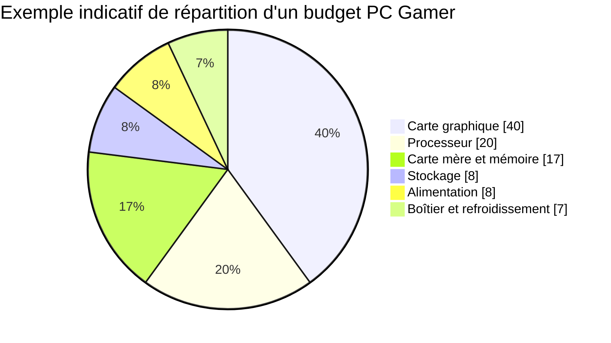
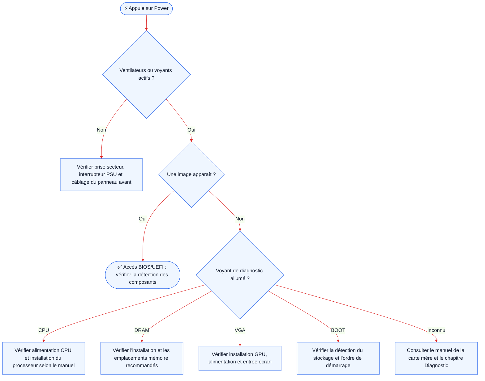

  
  

# ⚡ PCperso — v2.0 Stable

### Le guide francophone pour choisir, monter et configurer son PC Gamer

**De la première idée au premier démarrage :** composants, compatibilité, montage, BIOS, système, diagnostic et entretien — expliqués clairement, sans jargon inutile.

 

 

[**✨ Nouveautés**](#nouveautes) · [**🧭 Parcours**](#parcours) · [**📚 Sommaire**](#sommaire) · [**🧰 Outils**](#outils) · [**🛡️ Sécurité**](#securite) · [**🩺 Diagnostic**](#diagnostic) · [**🤝 Contribution**](#entraide)

---

## 🎯 À propos

PCperso est une documentation communautaire pour aider à **concevoir, assembler, configurer et dépanner un PC**. Le guide s’adresse aux personnes qui montent leur première machine comme aux passionnés qui veulent vérifier une configuration ou faire évoluer un ordinateur existant.

> [!TIP]
> **Un parcours clair, à ton rythme :** définis ton usage et ton budget, vérifie les composants et les dimensions, assemble méthodiquement, puis teste la machine avant de l’utiliser au quotidien.

### Ce que tu trouveras ici

| Besoin | Ressource |
|:--|:--|
| **Choisir une configuration** | Guide de compatibilité, profils d’usage et outils de budget. |
| **Préparer le montage** | Repérage des connecteurs, checklist et fiche mémo. |
| **Assembler et démarrer** | Parcours guidé du montage jusqu’au BIOS/UEFI. |
| **Résoudre un problème** | Arbre de diagnostic, glossaire et chapitre dépannage. |
| **Installer des outils** | Documentation et scripts à examiner avant exécution. |

---

## ✨ Édition v2.0 Stable

La v2.0 rassemble les améliorations documentaires et les ressources du dépôt dans une navigation guidée. Elle met l’accent sur la **compatibilité**, la **sécurité du montage** et l’accès rapide aux outils. Les standards et fonctionnalités matérielles évoluent : vérifie toujours les spécifications du fabricant pour les pièces que tu envisages.

- **Navigation plus directe :** sommaire par étapes, liens internes et accès aux outils associés.
- **Vérifications avant achat :** sockets, mémoire, dégagements du boîtier, connectique et alimentation.
- **Aide au montage :** checklist, fiche mémo et chapitres consacrés au câblage et au premier démarrage.
- **Sécurité renforcée :** rappels sur les manipulations électriques, les câbles modulaires et l’examen des scripts.
- **Ressources pratiques :** profils de configuration, modèle de budget et aide à l’évolution d’un PC existant.

<strong>🕰️ Historique des paliers documentés</strong>

| Version | Thème | Évolution présentée |
|:--:|:--|:--|
| **v1.3** | Dimensions et stockage | Dégagements physiques, NVMe et périphériques. |
| **v1.4** | Démarrage et diagnostic | Pannes de premier démarrage et indicateurs de carte mère. |
| **v1.5** | Comparaison | Présentation comparative des configurations. |
| **v1.6** | Sécurité et accessibilité | Consignes de montage et lisibilité de la documentation. |
| **v1.7** | Configurations et évolutivité | Profils par résolution et pistes d’évolution. |
| **v1.8** | Qualité du dépôt | Organisation documentaire et modèles GitHub. |
| **v1.9** | Release candidate | Harmonisation des chapitres, fiches et checklists. |
| **v2.0** | **Stable** | Documentation consolidée et parcours unifié. |

Pour le détail, consulte [`CHANGELOG.md`](./CHANGELOG.md) et [`ROADMAP.md`](./ROADMAP.md).

---

## 🧭 Parcours de montage

```mermaid
%%{init: {"theme":"base","themeVariables":{"primaryColor":"#DBEAFE","primaryTextColor":"#0F172A","primaryBorderColor":"#2563EB","lineColor":"#64748B","secondaryColor":"#FEE2E2","tertiaryColor":"#EFF6FF","fontFamily":"Arial"}}}%%
flowchart LR
    A["🎯 Usage et budget"] --> B["🧩 Choix et compatibilité"]
    B --> C["🔌 Préparation des pièces"]
    C --> D["🛠️ Montage et câblage"]
    D --> E["⚙️ BIOS, système et pilotes"]
    E --> F["🧪 Tests, entretien et évolutions"]
    classDef blue fill:#DBEAFE,stroke:#2563EB,color:#0F172A,stroke-width:2px
    classDef red fill:#FEE2E2,stroke:#DC2626,color:#0F172A,stroke-width:2px
    class A,B,C,D,E blue
    class F red
```

### Répartition budgétaire : point de départ, pas règle absolue

La répartition ci-dessous est **indicative**. Les prix, disponibilités et priorités changent selon le pays, la période, la résolution ciblée et les composants déjà possédés. Utilise le calculateur et compare des prix réels avant achat.

---

## 📚 Sommaire opérationnel

Suis les chapitres dans l’ordre pour un premier montage. Si tu as déjà un PC, passe directement au guide d’upgrade ou au diagnostic.

| Étape | Chapitre | Objectif | Accès |
|:--:|:--|:--|:--|
| **01** | 🧩 **Composants et compatibilité** | Vérifier plateforme, socket, mémoire, dimensions et alimentation. | [Ouvrir le chapitre](./guide/01-composants-compatibilite.md) |
| **02** | 🔌 **Préparation et connecteurs** | Identifier les câbles, prises et éléments à préparer. | [Ouvrir le chapitre](./guide/02-preparation-et-connecteurs.md) |
| **03** | 🛠️ **Assemblage et câblage** | Installer les composants et réaliser les branchements. | [Ouvrir le chapitre](./guide/03-assemblage-et-cablage.md) |
| **04** | ⚙️ **BIOS / UEFI et profils mémoire** | Découvrir les réglages de démarrage et les profils mémoire. | [Ouvrir le chapitre](./guide/04-bios-uefi-et-xmp-expo.md) |
| **05** | 🪟 **Système, pilotes et tests** | Installer le système, les pilotes et vérifier l’affichage. | [Ouvrir le chapitre](./guide/05-windows-pilotes-et-tests.md) |
| **06** | 🩺 **Diagnostic et pannes** | Suivre une démarche de dépannage pour les symptômes courants. | [Ouvrir le chapitre](./guide/06-diagnostic-et-pannes.md) |
| **07** | 📖 **Glossaire matériel** | Comprendre les acronymes et termes du matériel PC. | [Ouvrir le chapitre](./guide/07-glossaire-hardware.md) |
| **08** | 🌬️ **Refroidissement et entretien** | Comprendre le flux d’air et les gestes d’entretien. | [Ouvrir le chapitre](./guide/08-refroidissement-et-entretien.md) |

**Raccourcis :** [Checklist](./CHECKLIST.md) · [Index des guides](./guide/README.md) · [Index des outils](./outils/README.md) · [Index des scripts](./scripts/README.md)

---

## 🧰 Outils, fiches et scripts

| Ressource | À quoi ça sert ? | Lien |
|:--|:--|:--|
| 🎯 **Configurations types** | Exemples de configurations par usage et budget à adapter aux prix et pièces disponibles. | [Consulter les configurations](./outils/configs-types.md) |
| 🧮 **Budget et puissance** | Organiser les achats et estimer les besoins de puissance à vérifier selon les spécifications des composants. | [Guide](./outils/calculateur-budget-puissance.md) · [Modèle CSV](./outils/modele-config-budget.csv) |
| 🔖 **Fiche mémo câblage et diagnostic** | Retrouver les vérifications courantes pendant le montage ou au premier démarrage. | [Ouvrir la fiche](./outils/fiche-memo-cablage-et-debug.md) |
| ✅ **Checklist de montage** | Suivre les étapes de préparation, assemblage et validation. | [Ouvrir la checklist](./CHECKLIST.md) |
| 🔄 **Guide d’upgrade** | Préparer l’évolution d’un PC existant. | [Ouvrir le guide](./outils/guide-upgrade-pc.md) |
| 🔍 **Vérificateur de compatibilité** | Aide documentaire à la vérification des composants. Confirme toujours les caractéristiques auprès des fabricants. | [Ouvrir l’outil](./outils/verificateur-compatibilite-2026.md) |
| ⚙️ **Pack logiciels** | Script PowerShell pour installer les logiciels référencés dans le dépôt. Lis-le et vérifie ses commandes avant toute exécution. | [Index des scripts](./scripts/README.md) · [Script PowerShell](./scripts/pack_logiciels_pc_neuf.ps1) |

---

## 🧩 Compatibilité : les contrôles essentiels

Avant d’acheter, confirme les points suivants dans les fiches techniques officielles des composants :

- **Processeur et carte mère :** socket, chipset, génération prise en charge et version BIOS nécessaire.
- **Mémoire :** type DDR, capacité, nombre de barrettes et compatibilité annoncée par la carte mère.
- **Carte graphique et boîtier :** longueur, épaisseur, dégagement des câbles et espace réservé aux ventilateurs ou radiateurs.
- **Refroidissement :** hauteur du ventirad, dimensions de l’AIO, compatibilité socket et dégagement autour de la mémoire.
- **Stockage :** format M.2, interface, lignes disponibles et partage éventuel de connecteurs selon la carte mère.
- **Alimentation :** puissance adaptée à la configuration et connecteurs exigés par le CPU et le GPU.
- **Usage visé :** résolution, fréquence d’écran, logiciels et budget total — périphériques compris.

> [!NOTE]
> Les normes évoluent et les recommandations de puissance ne remplacent pas les consignes des fabricants. Les valeurs d’un configurateur ou d’un exemple restent des points de départ à valider.

---

## 🛡️ Sécurité matérielle et logicielle

> [!WARNING]
> **Avant toute intervention dans le boîtier :** éteins l’ordinateur, coupe l’alimentation et débranche le câble secteur. Manipule les composants avec précaution et évite les surfaces générant de l’électricité statique.

- **Câbles modulaires :** n’utilise que les câbles fournis ou explicitement certifiés compatibles avec le modèle exact de ton alimentation. Une même marque ne garantit pas un brochage identique.
- **Connecteurs GPU :** utilise le câble et la méthode de branchement prévus par le fabricant. Insère complètement le connecteur et respecte le rayon de courbure et les dégagements indiqués dans sa documentation.
- **Refroidissement :** vérifie la notice et retire les films de protection indiqués avant l’installation du refroidisseur.
- **BIOS/UEFI :** ne lance une mise à jour que si elle est nécessaire, avec le fichier exact du fabricant et une alimentation stable. N’interromps pas la procédure.

> [!CAUTION]
> **Avant d’exécuter un script :** ouvre et lis son contenu, vérifie les commandes et les sources de téléchargement, puis décide si chaque action est appropriée à ton système. Ne lance pas un script avec des privilèges élevés sans comprendre ce qu’il fait. Le script du dépôt n’est pas présenté ici comme audité ou sans risque.

---

## 🩺 Diagnostic express au premier démarrage

Ce schéma donne des contrôles de départ. Consulte le manuel de la carte mère et le chapitre dépannage si les voyants, codes ou procédures diffèrent.

Pour la suite, consulte le [**chapitre 06 — Diagnostic et pannes**](./guide/06-diagnostic-et-pannes.md) et la [fiche mémo](./outils/fiche-memo-cablage-et-debug.md).

---

## 🚀 Parcours express

<strong>Afficher les étapes recommandées pour le jour du montage</strong>

1. **Avant l’achat :** définis ton usage, fixe un budget et parcours le [chapitre 01](./guide/01-composants-compatibilite.md).
2. **Avant d’assembler :** consulte le [chapitre 02](./guide/02-preparation-et-connecteurs.md), la [checklist](./CHECKLIST.md) et les notices des fabricants.
3. **Pendant le montage :** suis le [chapitre 03](./guide/03-assemblage-et-cablage.md) et évite de forcer un connecteur ou un composant.
4. **Au premier démarrage :** vérifie la détection du matériel dans le BIOS/UEFI avant d’installer le système.
5. **Après installation :** consulte les guides pilotes/tests et configure le refroidissement selon les recommandations du fabricant.

---

## 🤝 Entraide, feuille de route et contribution

| Besoin | Ressource |
|:--|:--|
| 🆘 **Poser une question ou signaler un problème** | [Issues du dépôt](https://github.com/teremuhamblin/PCperso/issues) |
| 🗺️ **Voir les évolutions prévues** | [`ROADMAP.md`](./ROADMAP.md), si présent à la racine. |
| 📋 **Consulter l’historique** | [`CHANGELOG.md`](./CHANGELOG.md), si présent à la racine. |
| 🛠️ **Contribuer** | Consulte les instructions de contribution du dépôt, si disponibles. |
| 📚 **Naviguer dans les guides** | [Index des chapitres](./guide/README.md) · [Documentation](./docs/README.md) |
| 🧰 **Explorer les ressources** | [Outils](./outils/README.md) · [Scripts](./scripts/README.md) |

---

## 📜 Licence

Consulte [`LICENSE`](./LICENSE) pour les conditions applicables à la réutilisation et au partage du contenu.

---

**PCperso v2.0 Stable** · Un guide communautaire pour monter son PC avec méthode  
[⬆️ Retour en haut](#top)

