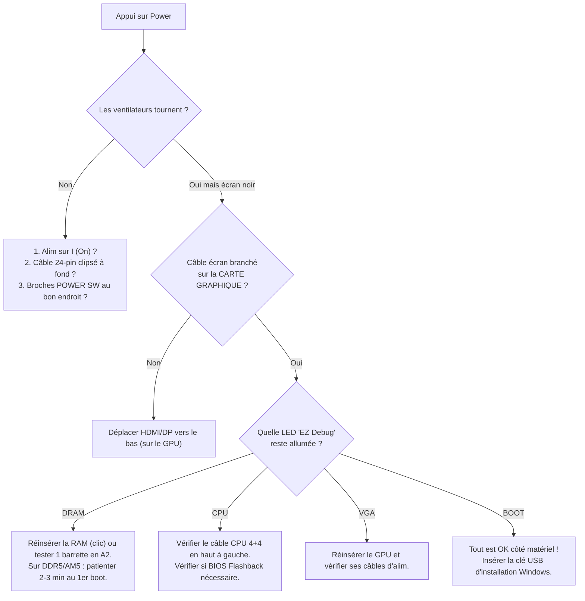

# 🔖 Fiche Mémo 1 Page — Câblage & Dépannage Express

Garde cette page ouverte sur ton téléphone ou imprime-la pendant l'assemblage pour éviter toute hésitation sur les câbles ou les voyants de démarrage.

---

## 🔌 Ne plus jamais confondre les câbles d'alimentation

| Nom sur le câble / prise | Nombre de broches | Destination exacte | Piège à éviter |
| :--- | :--- | :--- | :--- |
| **`ATX` / `MB`** | `24 pins` (ou `20+4`) | Bord droit de la carte mère | Très ferme à clipser : soutiens la carte mère par dessous. |
| **`CPU` / `EPS`** | `8 pins` (`4+4` détachables) | Haut gauche de la carte mère | **Ne jamais forcer un câble PCIe GPU ici !** |
| **`PCIe` / `VGA`** | `8 pins` (`6+2` détachables) | Carte graphique (GPU) | Utilise 2 câbles séparés depuis l'alim si le GPU a 2 prises. |
| **`12VHPWR` / `12V-2x6`** | `16 pins` (12+4 petits) | Carte graphique récente | Enfoncer à 100 % sans aucun jour visible, pas de pliure serrée. |
| **`SATA Power`** | Prise plate en "L" | Disques SATA / contrôleur RGB | Ne se branche jamais sur la carte mère, uniquement sur les périphériques. |

---

## 🚨 Que faire si ça ne démarre pas ? (Arbre express)

